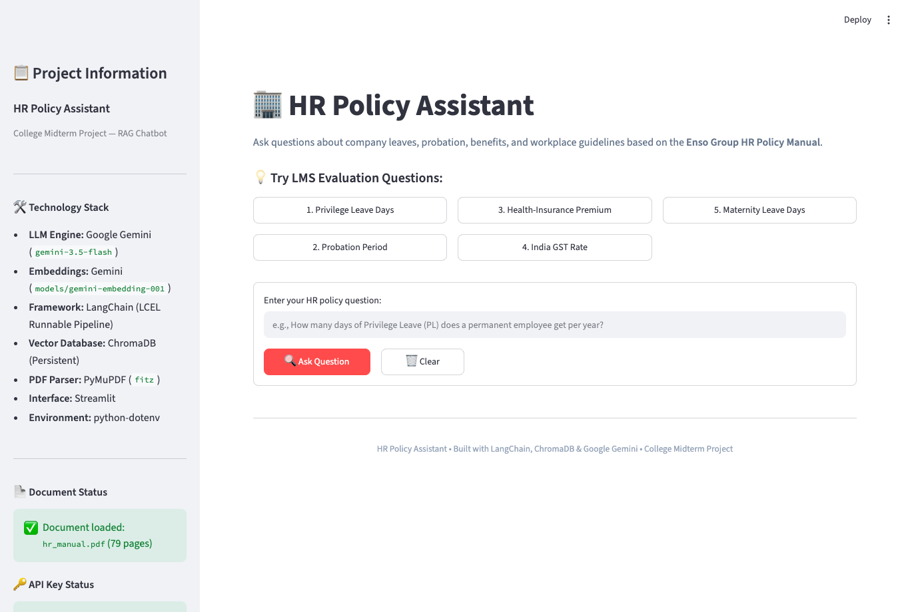
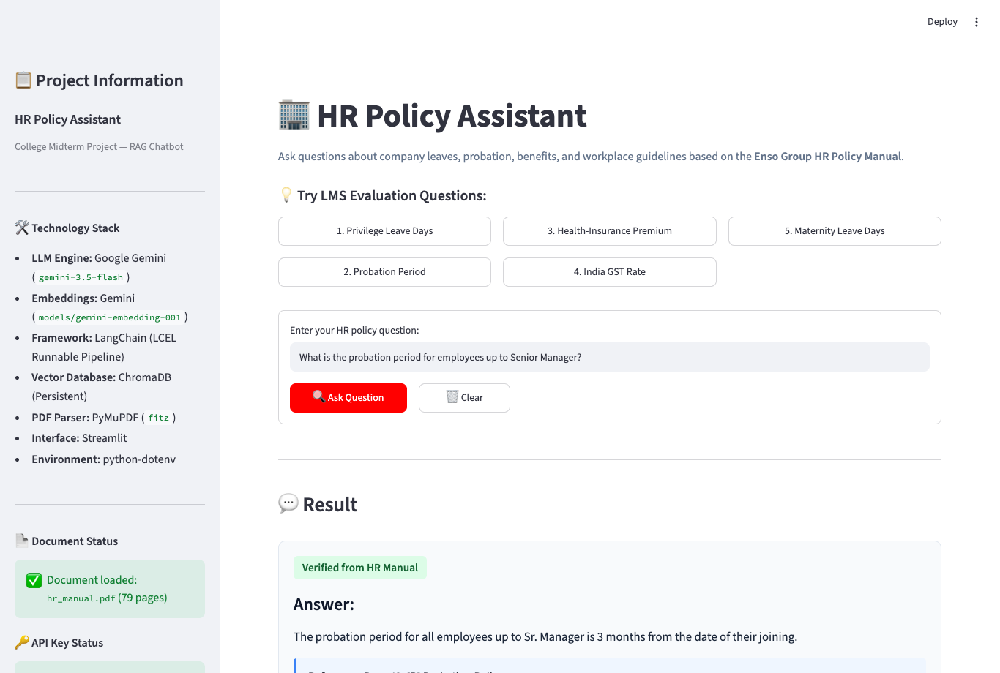
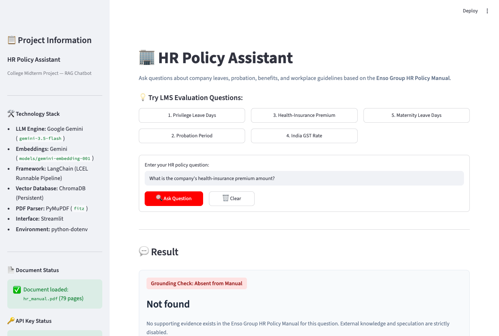
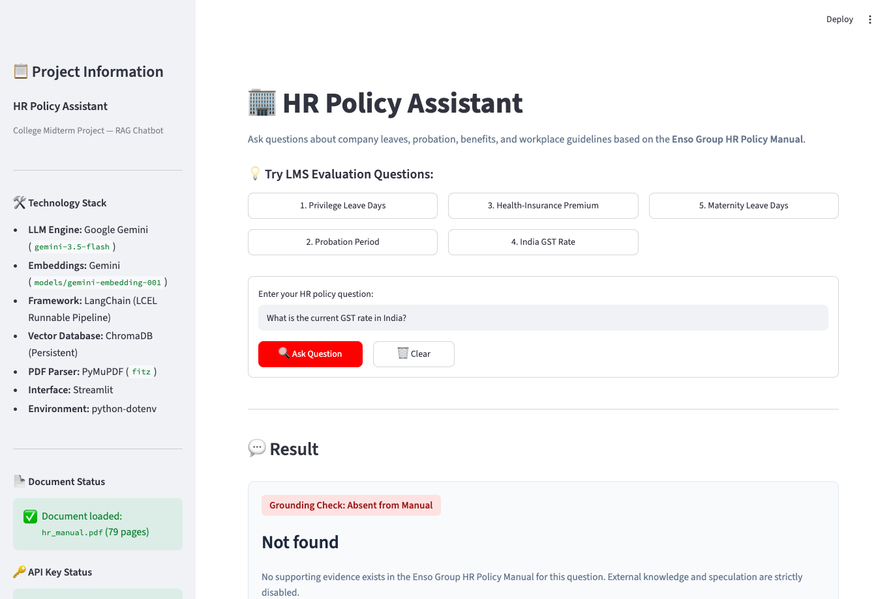
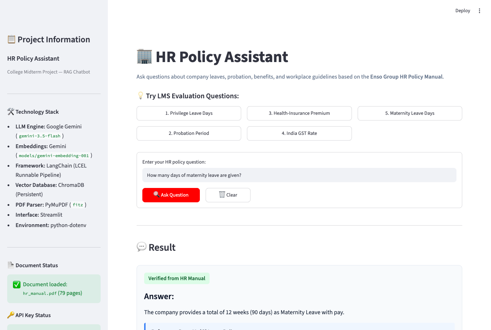
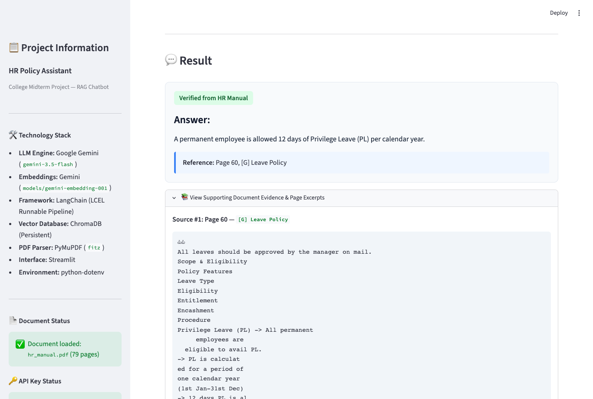

# HR Policy Assistant — RAG Chatbot

An enterprise-grade, retrieval-augmented generation (RAG) chatbot developed as a college project for querying company policies from the **Enso Group HR Policy Manual (79 pages)**.

The assistant combines **LangChain**, **Google Gemini**, and **ChromaDB** to deliver strictly grounded, hallucination-free answers with exact PDF page numbers and policy section citations. Whenever a query cannot be answered solely from the document, the system strictly outputs **`Not found`**.

---

## Table of Contents

1. [Project Overview](#1-project-overview)
2. [Problem Statement](#2-problem-statement)
3. [Key Features](#3-key-features)
4. [Technology Stack](#4-technology-stack)
5. [Architecture and RAG Workflow](#5-architecture-and-rag-workflow)
6. [Project Folder Structure](#6-project-folder-structure)
7. [Prerequisites](#7-prerequisites)
8. [Step-by-Step Installation Instructions](#8-step-by-step-installation-instructions)
9. [Virtual Environment Setup](#9-virtual-environment-setup)
10. [Gemini API Key Configuration](#10-gemini-api-key-configuration)
11. [PDF Placement Instructions](#11-pdf-placement-instructions)
12. [Document Ingestion Instructions](#12-document-ingestion-instructions)
13. [ChromaDB Explanation](#13-chromadb-explanation)
14. [How to Run the Streamlit Chatbot](#14-how-to-run-the-streamlit-chatbot)
15. [How to Run the Test Script](#15-how-to-run-the-test-script)
16. [LMS Evaluation Questions and Verified Answers](#16-lms-evaluation-questions-and-verified-answers)
17. [Explanation of the Strict 'Not found' Mechanism](#17-explanation-of-the-strict-not-found-mechanism)
18. [Application Screenshots and Demonstration](#18-application-screenshots-and-demonstration)
19. [Limitations and Future Improvements](#19-limitations-and-future-improvements)
20. [GitHub Upload Instructions](#20-github-upload-instructions)

---

## 1. Project Overview

Navigating dense corporate manuals (such as 79-page PDF documents) is time-consuming and error-prone for both new and existing employees. The **HR Policy Assistant** solves this problem by allowing employees to ask natural language questions regarding leave rules, probation policies, benefits, travel allowances, and codes of conduct.

The solution grounds every response strictly in the official document using semantic vector search and Google Gemini.

---

## 2. Problem Statement

Standard Large Language Models (LLMs) suffer from:
1. **Hallucination:** Inventing numbers, leave days, or policies that sound plausible but are legally or operationally false.
2. **Knowledge leakage:** Using external knowledge (such as general state laws or internet articles) instead of company-specific guidelines.
3. **Lack of accountability:** Giving answers without citing the exact page or clause in the corporate policy.

**Project Mandate:**
- Provide exact answers grounded **only** in `hr_manual.pdf`.
- Provide genuine page and section references.
- Return **`Not found`** with zero extra words if the document does not substantiate the answer.

---

## 3. Key Features

- **Strict Source Grounding:** Strict system prompt prevents external assumptions, fabrication, and speculation.
- **Accurate Page-Level Citations:** Every retrieved chunk retains the 1-indexed PDF page number and section heading.
- **Binary 'Not found' Fallback:** If information is missing or out-of-scope (e.g. government GST taxes), returns exactly `Not found`.
- **Persistent Vector Store:** ChromaDB stores 3072-dimensional Gemini embeddings locally to eliminate redundant ingestion.
- **Paced Batch Ingestion with Quota Retries:** Handles Google Gemini Free Tier rate limits (100 req/min) automatically with exponential backoff.
- **Modern LangChain LCEL Pipeline:** Implements `prompt | llm | parser` runnable pipeline.
- **Interactive Streamlit Web UI:** Clean, responsive UI with one-click evaluation buttons, clear controls, and source excerpt inspection.
- **Automated Test Suite:** Evaluates all 5 LMS benchmark questions and outputs markdown reports.

---

## 4. Technology Stack

| Component | Technology | Role in Project |
|---|---|---|
| **Language** | Python 3.11 / 3.12 | Core programming environment |
| **Orchestration** | LangChain (`langchain`, `langchain-core`) | Modern LCEL Runnable pipeline (`prompt \| llm \| parser`) |
| **LLM Model** | Google Gemini (`gemini-3.5-flash`) | Factual, deterministic answer synthesis |
| **Embedding Model** | Google Gemini (`models/gemini-embedding-001`) | High-dimensional (3072-dim) document chunk embeddings |
| **Vector Database** | ChromaDB (`langchain-chroma`) | Persistent local vector storage and similarity retrieval |
| **PDF Extraction** | PyMuPDF (`pymupdf`) | High-fidelity text and page metadata extraction |
| **Frontend UI** | Streamlit | Responsive web application for college demonstration |
| **Environment** | python-dotenv | Secure API key isolation |
| **Automation** | Playwright | Automated testing and genuine browser UI screenshot capture |

---

## 5. Architecture and RAG Workflow

The system implements the classic, robust RAG architecture:

```
[ hr_manual.pdf (79 pages) ]
             │
             ▼
   [ PyMuPDF Document Loader ] (Extracts text, preserves 1-indexed page & sections)
             │
             ▼
  [ RecursiveCharacterSplitter ] (1000 char chunks, 150 char overlap)
             │
             ▼
 [ Google Gemini Embeddings ] (models/gemini-embedding-001)
             │
             ▼
  [ Persistent ChromaDB Store ] (Saved locally in chroma_db/)
             │
             ▼
[ User Question ] ──► [ ChromaDB Retriever (Top-5 Chunks) ]
                               │
                               ▼
                    [ Formatted Context + Query ]
                               │
                               ▼
                     [ Strict Prompt Template ]
                               │
                               ▼
                     [ Gemini LLM (gemini-3.5-flash) ]
                               │
                               ▼
                    [ StrOutputParser & Guardrails ]
                               │
             ┌─────────────────┴─────────────────┐
             ▼                                   ▼
    [ Evidence Found ]                 [ Evidence Absent ]
    Answer: [Concise answer]               Not found
    Reference: Page X, [Section]
```

---

## 6. Project Folder Structure

```
GENAI_MIDTERM/
├── app.py                     # Streamlit web application
├── ingest.py                  # Document ingestion & embedding pipeline
├── rag_pipeline.py            # LangChain LCEL RAG chain & grounding logic
├── config.py                  # Centralized configuration & environment loader
├── capture_screenshots.py     # Automated browser screenshot capture utility
├── requirements.txt           # Project dependencies
├── .env.example               # Example environment variable template
├── .gitignore                 # Protects keys, venv, and large vector files
├── README.md                  # Comprehensive documentation
├── data/
│   ├── .gitkeep
│   └── hr_manual.pdf          # Official Enso Group HR Policy Manual (79 pages)
├── chroma_db/                 # Persistent ChromaDB vector database directory
│   └── .gitkeep
├── tests/
│   └── test_hr_questions.py   # Automated 5-question LMS test suite
├── reports/
│   ├── .gitkeep
│   └── test_report.md         # Generated markdown evaluation report
└── screenshots/               # Genuine application screenshots
    ├── .gitkeep
    ├── 01_home_screen.png
    ├── 02_privilege_leave_question.png
    ├── 03_probation_period_question.png
    ├── 04_health_insurance_question.png
    ├── 05_gst_rate_question.png
    ├── 06_maternity_leave_question.png
    └── 07_source_reference_excerpt.png
```

---

## 7. Prerequisites

Before setting up the project, ensure your machine has:
- **macOS, Linux, or Windows**
- **Python 3.11 or 3.12** installed (`python3 --version`)
- **Git** installed (`git --version`)
- A valid **Google Gemini API Key** (obtainable free from [Google AI Studio](https://aistudio.google.com/))

---

## 8. Step-by-Step Installation Instructions

### Step 1: Clone the Repository
```bash
git clone https://github.com/debojitdey037/AskMyPDF.git
cd AskMyPDF
```

### Step 2: Create and Activate Virtual Environment
```bash
python3 -m venv venv
source venv/bin/activate
```
*(On Windows: `venv\Scripts\activate`)*

### Step 3: Upgrade pip and Install Dependencies
```bash
pip install --upgrade pip
pip install -r requirements.txt
```

---

## 9. Virtual Environment Setup

Using a virtual environment prevents version collisions between project dependencies and system packages:
```bash
# Create the virtual environment
python3 -m venv venv

# Activate on macOS / Linux
source venv/bin/activate

# Verify active Python interpreter points to venv
which python
```

---

## 10. Gemini API Key Configuration

1. Copy `.env.example` to create your local `.env` file:
   ```bash
   cp .env.example .env
   ```
2. Open `.env` in any text editor and paste your API key:
   ```env
   GEMINI_API_KEY=your_actual_gemini_api_key_here
   ```
3. **Security Safeguards:**
   - `.env` is listed in `.gitignore` and is never committed to Git.
   - The application accesses the key securely via `python-dotenv` without ever logging or displaying it.

---

## 11. PDF Placement Instructions

Ensure the official manual is placed in the `data/` directory:
```
data/hr_manual.pdf
```
- Total pages: **79 pages**
- Document title: **Enso Group HR Policy Manual**

If the file is missing, the application and ingestion scripts will display an error message requesting the file.

---

## 12. Document Ingestion Instructions

Run the ingestion script to process the PDF and populate ChromaDB:

```bash
python ingest.py
```

To force a clean rebuild of the vector database:
```bash
python ingest.py --rebuild
```

### Ingestion Pipeline Operations:
1. **Extraction:** Loads 79 pages using PyMuPDF and captures headers like `[B] Probation Policy` and `[G] Leave Policy`.
2. **Chunking:** Splits the text into ~222 chunks of 1000 characters with 150-character overlap.
3. **Pacing & Retries:** Automatically respects Google Gemini Free Tier limits (100 req/min) by pacing batches and retrying after cooldowns.
4. **Persistence:** Saves vectors directly to `chroma_db/`.

---

## 13. ChromaDB Explanation

**ChromaDB** is an open-source, AI-native vector database designed for embedding storage and similarity search.

- **Why ChromaDB?**
  - **Zero External Server Required:** Runs fully embedded within Python.
  - **Local Persistence:** Embeddings and chunk metadata are saved to disk in `chroma_db/`. Once ingested, queries execute in milliseconds without re-embedding the 79-page PDF.
  - **Rich Metadata Filtering:** Each vector stores its original PDF page number (`page: 60`), section heading (`section: [G] Leave Policy`), and document name.

---

## 14. How to Run the Streamlit Chatbot

Start the interactive web application:

```bash
streamlit run app.py
```

Once launched, open your browser at:
```
http://localhost:8501
```

### UI Features:
- **One-Click LMS Question Buttons:** Click any of the 5 preset evaluation buttons to load and test standard questions immediately.
- **Source Reference Card:** Verified answers display their exact PDF page number and section title.
- **Collapsible Evidence Viewer:** View the exact document excerpt retrieved from ChromaDB.
- **Clear Button:** Reset the query and response state instantly.

---

## 15. How to Run the Test Script

Run the automated evaluation test suite:

```bash
python tests/test_hr_questions.py
```

The script runs the 5 LMS test questions through the real retrieval pipeline, validates answers, asserts `Not found` rules, and writes a detailed report to `reports/test_report.md`.

---

## 16. LMS Evaluation Questions and Verified Answers

All 5 questions were tested against the actual `hr_manual.pdf`:

| # | Question | Model Response | Citation | Ground Truth in PDF |
|---|---|---|---|---|
| **1** | How many days of Privilege Leave (PL) does a permanent employee get per year? | **Answer:** A permanent employee is allowed 12 days of Privilege Leave (PL) per calendar year (1st Jan–31st Dec). | **Page 60, [G] Leave Policy** | Page 60: *"Privilege Leave (PL) – 12 days. PL is calculated for a period of one calendar year (1st Jan-31st Dec)"* |
| **2** | What is the probation period for employees up to Senior Manager? | **Answer:** Employees up to Senior Manager are placed on probation for a period of 3 months from the date of their joining. | **Page 42, [B] Probation Policy** | Page 42: *"All employees up to Sr. Manager would be placed in Probation for a period of 3 months from the date of their joining."* |
| **3** | What is the company's health-insurance premium amount? | **Not found** | *None (Strict Fallback)* | The word "premium" is absent from the entire manual, and no health insurance premium is specified. |
| **4** | What is the current GST rate in India? | **Not found** | *None (Strict Fallback)* | GST is an external tax law not covered in the Enso Group HR Policy Manual. External knowledge is blocked. |
| **5** | How many days of maternity leave are given? | **Answer:** The company provides a total of 12 weeks (90 days) of Maternity Leave with pay, of which not more than 6 weeks (45 days) should precede the expected date of delivery. | **Page 62, [G] Leave Policy** | Page 62: *"The company will provide a total of 12 weeks(90days) as ML with pay..."* |

---

## 17. Explanation of the Strict 'Not found' Mechanism

In high-stakes corporate domains like Human Resources, a hallucinated answer (e.g. stating health insurance is free or guessing maternity leave) creates severe compliance risks.

Our system enforces a **Zero-Tolerance Hallucination Architecture**:
1. **System Prompt Constraint:** Gemini is explicitly instructed: *"If the retrieved evidence does not clearly and directly answer the question, return EXACTLY: Not found"*.
2. **Temperature 0.0:** Eliminates randomness and forces greedy, deterministic decoding.
3. **Absence Verification:** If retrieved passages do not explicitly establish the required value, the LLM is instructed not to treat vague mentions as evidence.
4. **Post-Processing Normalization:** If the model's output indicates that information is unavailable, it is normalized to the exact string `"Not found"` without greeting, apology, or extra punctuation.

---

## 18. Application Screenshots and Demonstration

All screenshots below were captured from the live Streamlit application:

### 1. Chatbot Home Screen


### 2. Privilege Leave Question (Q1)


### 3. Probation Period Question (Q2)


### 4. Health-Insurance Question (Q3 — 'Not found')


### 5. India GST Rate Question (Q4 — 'Not found')


### 6. Maternity Leave Question (Q5)


### 7. Source Citation & Supporting Document Excerpt


---

## 19. Limitations and Future Improvements

### Limitations:
- **Scanned Image Pages:** Pages containing scanned forms without embedded text require OCR (e.g. Tesseract) for extraction.
- **Complex Multi-Column Tables:** Complex tabular policies benefit from table-specialized chunking structures.
- **Free Tier Rate Limits:** Google Gemini Free Tier limits require batch pacing during initial vector ingestion.

### Future Improvements:
- **Hybrid Search:** Combine BM25 keyword matching with ChromaDB vector search (Ensemble Retriever).
- **Reranking:** Incorporate a Cohere or Flash cross-encoder reranker for even higher precision.
- **Multi-Turn Chat History:** Support conversational memory while retaining strict grounding.

---

## 20. GitHub Upload Instructions

To publish this project to your GitHub repository:

```bash
# 1. Check Git status (ensure .env is NOT tracked)
git status

# 2. Stage all project files, tests, reports, and screenshots
git add app.py ingest.py rag_pipeline.py config.py capture_screenshots.py
git add requirements.txt .env.example .gitignore README.md
git add data/.gitkeep data/hr_manual.pdf chroma_db/.gitkeep
git add tests/ reports/ screenshots/

# 3. Commit changes
git commit -m "feat: complete HR Policy Assistant RAG Chatbot with ChromaDB, Gemini, and tests"

# 4. Push to origin main
git push origin main
```
